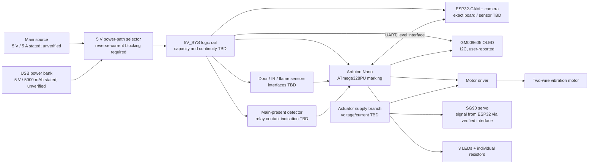

# System Block Diagram (Preliminary)

This is a planning schematic, not a validated circuit or wiring instruction. All rails and interfaces are conditional on checking the actual module documentation and measurements. Keep all mains-voltage conversion inside an enclosed, certified supply; this drawing begins at low-voltage DC only.

## Power-flow concept

- Keep the main 5 V source and USB power-bank output as separate inputs to a suitably rated power-mux or ideal-diode arrangement with reverse-current blocking. Do not tie the sources directly together.
- A single selected `5V_SYS` rail can feed logic only after each board's permitted supply input path is established. Add a separately protected actuator branch sized for the vibration motor and servo; the branch may originate from `5V_SYS` only if the source and selector are verified to handle the combined transients.
- The selector is not selected, and the power bank's current limit, low-load shutdown behavior, pass-through behavior, and transfer hold-up are unknown. Automatic and seamless backup are not claimed.
- Power-failure status is a separate logic function. A relay contact may report the main-source state to the Nano after the relay module circuit and contact behavior are verified. Relay contacts are not the proposed source selector.
- Nano sensor monitoring and local alerts must continue if the ESP32-CAM, camera, UART, servo, or Wi-Fi is unavailable.

See [power-management design](power-management.md), [netlist](netlist.md), and [design decisions](design-decisions.md).
